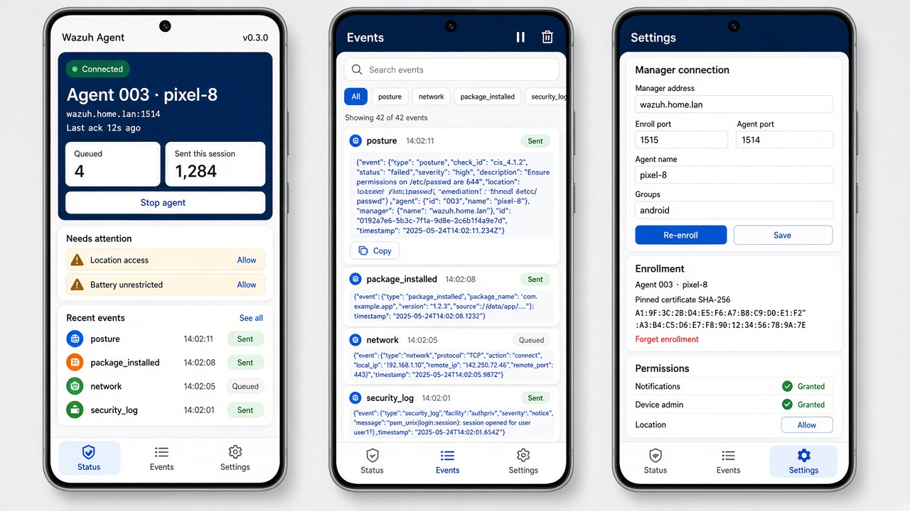
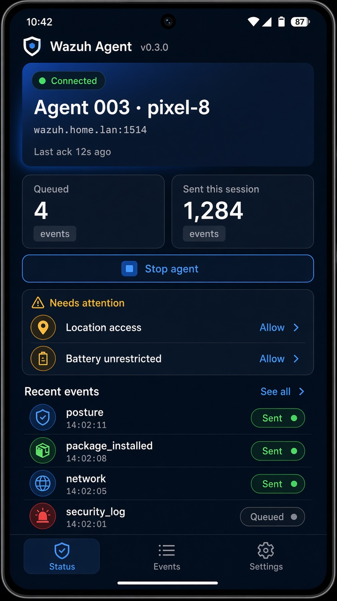

# Wazuh Android Agent

A native Kotlin agent for Android phones. Root is not required. It enrolls with a Wazuh manager
through `wazuh-authd` (TLS, port 1515), then speaks the regular agent protocol to
`wazuh-remoted` (AES, port 1514), so the phone shows up in the dashboard as a normal
active agent.

It reports:

- **Posture**: screen lock, encryption, patch age, developer options, USB and wireless
  debugging, root and emulator indicators, verified boot, and device admin, accessibility
  and notification-listener apps.
- **Apps**: installs, updates and removals, with the installer, sideload flag, granted
  dangerous permissions, and the signer SHA-256. A new or updated app, and the first
  inventory, also include the APK SHA-256. Later reconciles do not hash unchanged apps.
- **Network**: changes in transport, VPN, addresses, DNS and Wi-Fi security. The Wi-Fi name
  is only included if you grant location permission.
- **Failed unlocks**: each wrong PIN, pattern or password, if you turn on the agent's device
  admin. The manager alerts on 5 failures within 5 minutes.
- **Capabilities**: what the agent can and cannot see on this phone (device admin, Device
  Owner, location, Usage Access, battery exemption), sent with each posture report and shown in the app.
- **Security and network logs** (Device Owner phones only): ADB shell commands, CA
  certificate installs, logging stopped, storage mounts, Bluetooth connections, keystore
  keys, backup changes, package installs the broadcast missed, an APK hash when it changes,
  and DNS lookups and connections per app. See [Device Owner mode](#device-owner-mode-optional).
- **Processes and memory**: RAM and swap every 15 minutes. On a rooted phone, the processes
  using the most memory. Otherwise, with Usage Access, the foreground app, recent apps and
  foreground services on Android 10 and newer. Usage Access does not include memory per app.
- **Agent log**: the app's own errors and crashes.

Events are queued in a local database while the phone is offline. The **Events** tab in the
app lists the last 500 events since the app started, whether each was sent yet, and the full
JSON on tap, with search, a filter per event type and a pause button.

## Screenshots

Design mockups of the app. The real screens follow the phone's light or dark mode.





## Layout

- `protocol/`: pure Kotlin/JVM implementation of enrollment, key derivation, the message
  codec, framing and the agent session. It has unit tests with vectors that were built
  independently from the Wazuh C sources.
- `app/`: the Android app (Compose UI, foreground service, collectors, Room queue,
  encrypted key storage).
- `manager/`: rules, optional app and domain lists, adb test scenarios and setup notes for
  the Wazuh manager. See [manager/README.md](manager/README.md).
- `provisioning/`: an example QR code payload for Device Owner setup.

## Build

Requirements: JDK 17 and the Android SDK (platform 35).

```sh
brew install openjdk@17
brew install --cask android-commandlinetools
export JAVA_HOME=/opt/homebrew/opt/openjdk@17/libexec/openjdk.jdk/Contents/Home
export ANDROID_HOME=/opt/homebrew/share/android-commandlinetools
sdkmanager "platform-tools" "platforms;android-35" "build-tools;35.0.0"
echo "sdk.dir=$ANDROID_HOME" > local.properties

./gradlew :protocol:test          # protocol unit tests
./build_app.sh                    # debug APK
./build_app.sh --release          # release APK, tag v<versionName>, GitHub Release
```

`./build_app.sh` runs `assembleDebug`. The APK is
`app/build/outputs/apk/debug/wazuh-agent-<version>-debug.apk`.
`./build_app.sh --release` runs `assembleRelease` for the `versionName` already in
`app/build.gradle.kts`. It refuses a detached HEAD, a dirty tree, or an existing
`v<versionName>` tag, pushes the current branch, and publishes a GitHub Release of
that commit. The release includes `wazuh-agent-<versionName>-release.apk` and
`wazuh-agent-release.apk`. The install page and the QR payload use
`https://github.com/skuilplek/wazuh-android-agent/releases/latest/download/wazuh-agent-release.apk`.

## Install on the phone

1. On the phone, enable **Developer options > USB debugging** and connect it by USB.
2. Run `$ANDROID_HOME/platform-tools/adb install -r app/build/outputs/apk/debug/wazuh-agent-*-debug.apk`.
3. Open **Wazuh Agent**. It opens on the **Settings** tab until the phone is enrolled. Enter
   the manager address, add the enrollment password if the manager uses one, then tap
   **Enroll**.
4. Allow the notification, and allow the app to run unrestricted in the background so
   Android does not kill the connection. While the agent is running it holds a wake lock
   so the session stays up with the screen off. **Run unrestricted in background** is still
   required on phones that kill foreground services anyway. On Android 12, also allow
   **Alarms and reminders** if the Status tab asks, so the agent can restart itself.
   The **Status** tab lists
   anything still missing under **Needs attention**.
5. Optionally, tap **Allow** next to **Device admin** to report failed unlock attempts. The
   admin only uses the "watch login" policy: it cannot lock, wipe or change the phone. If it
   is turned off later, the manager gets an alert (rule 100265).
6. To report which apps are in the foreground, tap **Allow** next to **App activity
   (running apps)**. Android opens the Usage Access screen; turn the app on there. With
   adb, either of these works:
   `adb shell appops set com.wazuh_mobile_client.android GET_USAGE_STATS allow` or
   `adb shell pm grant com.wazuh_mobile_client.android android.permission.PACKAGE_USAGE_STATS`.
   On a rooted phone the process list comes from `ps` instead, including memory per
   process. Allow the app in the root manager first. Magisk shows a prompt the first time
   and the agent waits 20 seconds for an answer. KernelSU shows nothing until the app is
   allowed there. If a prompt was shown and denied or left to expire, the agent tries again
   after an hour. A denial the root manager has saved is retried once a day.

The app pins the manager's enrollment certificate the first time it enrolls. Later
enrollments to the same host must present the same certificate.

There are two versions:

- **App version** (`versionName`+`versionCode` in `app/build.gradle.kts`, for example
  `0.2.0+2`). It is shown in the app, sent in every event as `android.app_version`, and
  sent as the agent label `agent.app_version`. Bump it for each build you install.
- **Wazuh protocol version**, which the app negotiates at enrollment. It picks the newest
  version the manager accepts, because Wazuh rejects agents that are newer than the manager.

Once enrolled, you can turn USB debugging off again. The agent reports it as a posture
finding while it is on.

## Device Owner mode (optional)

On a phone dedicated to the agent, you can make it the Device Owner. The agent then turns on
Android's security log and network log. It sets no other policy unless you turn on
**Organization policy** in Settings, or set `org_policy` to `true` in the QR extras. That
blocks sideloading, installs system updates when they are published, and requires a medium
screen lock. This needs a factory-reset phone with no Google or other accounts added.

The manager can ask a Device Owner phone to suspend, hide, clear, or uninstall an app, lock
the phone, or report its location for that command only. A wipe runs only when the command's
extra arguments include `confirm-wipe`. The phone ignores every other active-response
command, and a device admin that is not Device Owner cannot run any of them.

With adb, after installing the app on the freshly reset phone:

```sh
adb shell dpm set-device-owner com.wazuh_mobile_client.android/io.github.hannescoetzee.wazuhagent.admin.AgentDeviceAdminReceiver
```

Then open the app and enroll as usual. The **Capabilities** card shows whether the security
and network logs are on. Android delivers both logs in batches, often an hour or more apart,
so these events arrive late. DNS lookups and connections are grouped per app and
destination in each batch.

To remove Device Owner, factory-reset the phone.

### QR provisioning

Instead of adb, a factory-reset phone can be set up from a QR code. It downloads the app, makes
it Device Owner and enrolls with the manager without anyone typing the settings.

1. The phone downloads the latest release. `PROVISIONING_DEVICE_ADMIN_PACKAGE_DOWNLOAD_LOCATION`
   in the example payload is already
   `https://github.com/skuilplek/wazuh-android-agent/releases/latest/download/wazuh-agent-release.apk`.
   You do not host the APK yourself.
2. Copy [`provisioning/qr_payload.example.json`](provisioning/qr_payload.example.json) and
   fill in:
   - `PROVISIONING_DEVICE_ADMIN_SIGNATURE_CHECKSUM`: the SHA-256 of the signing certificate
     of that downloaded APK, not of a build on your computer, base64url-encoded. The checksum
     stays valid for later releases only while they are signed with the same key.
     ```sh
     curl -fsSL -o wazuh-agent-release.apk \
       https://github.com/skuilplek/wazuh-android-agent/releases/latest/download/wazuh-agent-release.apk
     apksigner verify --print-certs wazuh-agent-release.apk | grep 'SHA-256' | head -1 | awk '{print $NF}' \
       | xxd -r -p | base64 | tr '+/' '-_' | tr -d '='
     ```
   - The admin extras: `manager_host`, `enroll_port`, `agent_port`, `enrollment_password`,
     `groups`, and optionally `agent_name`, `keepalive_seconds`, and `org_policy` (`true` to
     turn on the organization policy above).
   - `manager_cert_sha256`: the SHA-256 of the manager's authd certificate, so the first
     enrollment is pinned instead of trusting whatever certificate it sees. Get it with
     `openssl x509 -in /var/ossec/etc/sslmanager.cert -noout -fingerprint -sha256`.
     Remove the key to trust the first certificate instead.
3. Turn the JSON into a QR code (for example `qrencode -o payload.png < payload.json`).
4. On the phone's welcome screen, tap six times to open the QR reader and scan the code.

If enrollment fails during setup (for example, the manager is not reachable yet), the
settings are kept and you can tap **Enroll** in the app later.

## Live protocol test (optional)

This enrolls a throwaway agent against a real manager:

```sh
WAZUH_MANAGER=192.168.1.10 WAZUH_PASSWORD=secret ./gradlew :protocol:test --tests '*LiveManagerTest*'
```

## Limitations

Without root, the agent cannot read the system logcat, monitor system file integrity, or
see other apps' data. The per-process list and memory per process need root. Without root
and without Usage Access, only system RAM and swap are reported. Security log and network
log events need Device Owner mode, which needs a factory-reset phone. Failed unlocks are only reported while the agent's device
admin is on. Remote upgrades (WPK) and remote configuration queries are not supported.
Active response is limited to the Device Owner commands above. Some OEM builds kill background services aggressively even with
the battery exemption. On those phones, also allow-list the app in the vendor's battery
settings.
